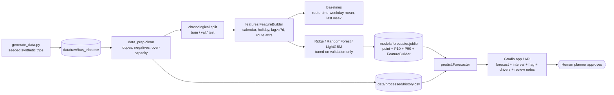

# Architecture & data schema

## Raw schema (`data/raw/bus_trips.csv`)
| column | type | known at forecast time (T-48h)? | used as feature? |
|---|---|---|---|
| trip_id | str | yes | no (identifier) |
| route_id, route_name, route_type | str | yes | yes (route_type, route one-hot) |
| distance_km, capacity | int | yes | yes |
| date, departure_time | date, HH:MM | yes | yes (calendar + slot features) |
| fare_inr | float | yes (pricing rule) | yes (missing → route median) |
| passengers | int | **no – TARGET** | target only; lagged ≥7 days as history |
| revenue_inr | float | **no – derived from target** | **never** |
| disruption | 0/1 | **no – known afterwards** | **never** (used only in error analysis) |
